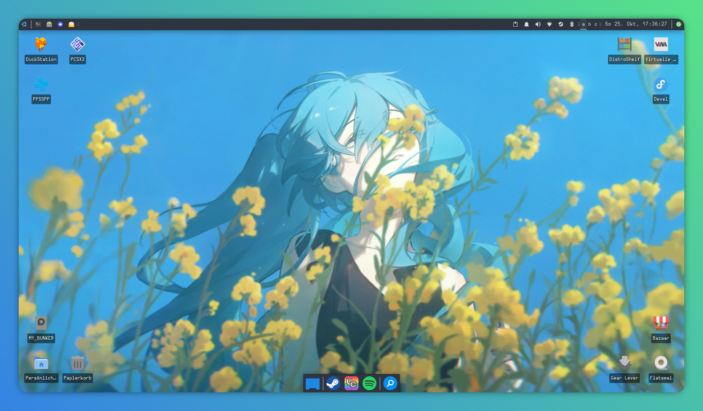
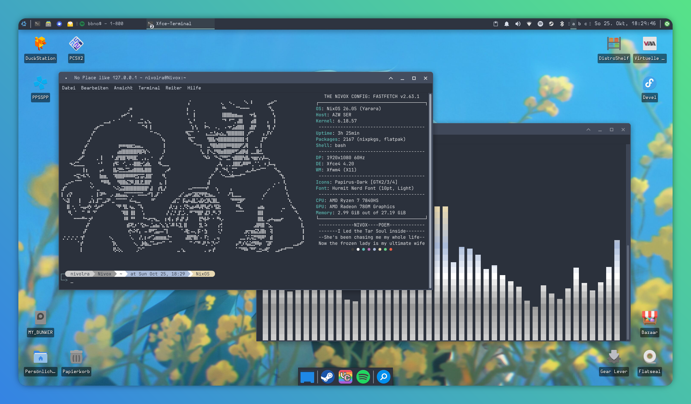
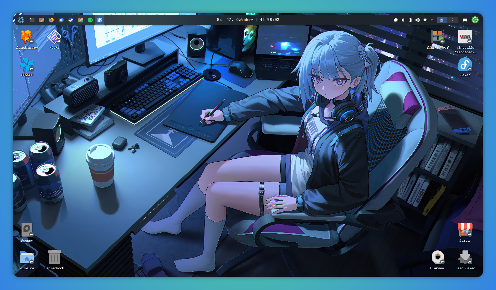
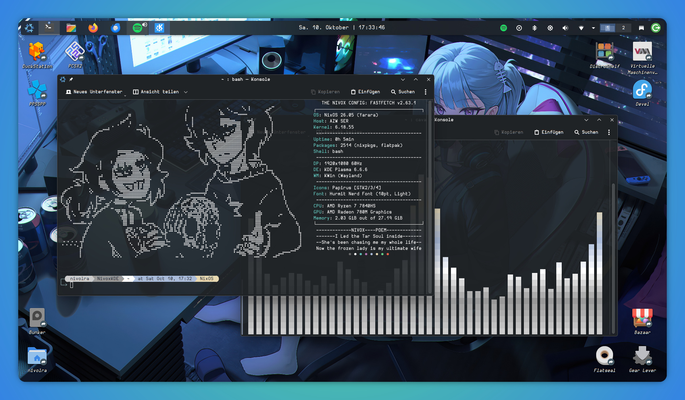

# Nivox-Nix

My Configuration Files for NixOS. Starting simple, I aim to gradually include a full Setup, for everyone to use and benefit from.
## Roadmap

Due to some limitations with the Eclipse WindowBuilder Plugin, I will need to run an X11 based Desktop environment for now. With this, I migrated to XFCE.

**Current Goals for now are the following:**

- Expand the Nix Configuration into multiple sensible modules
- Create derivations for KDE, XFCE and Niri
- Migrate to Flakes
### XFCE Version Concept

---

### KDE Version Concept

---

